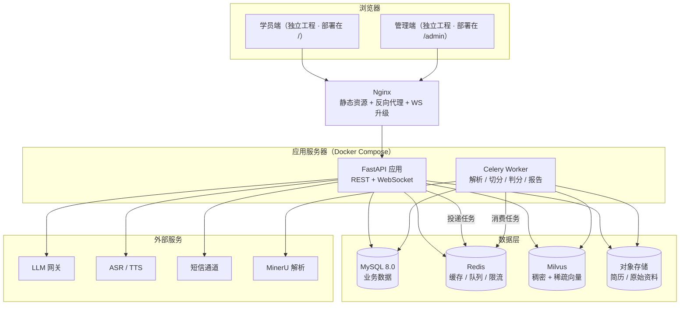
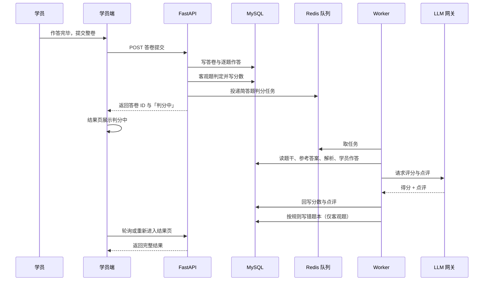
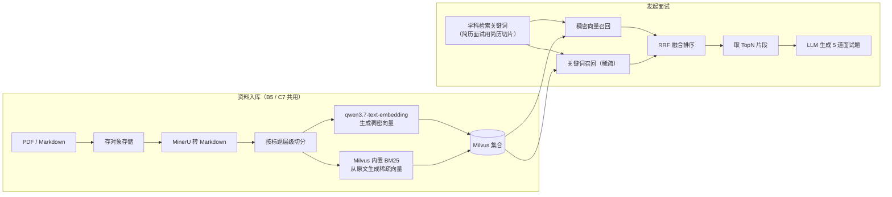
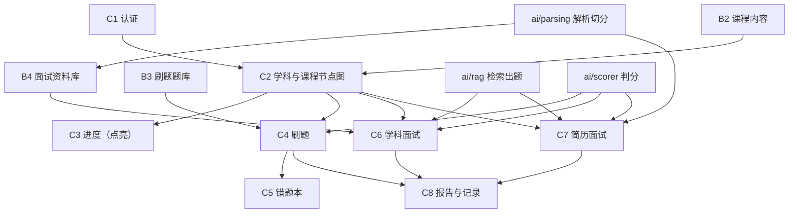

# 云枢智学 · 第二阶段设计：技术选型与整体架构

| 项 | 内容 |
|---|---|
| 文档版本 | v2.1（前端拆为两个独立工程，待评审） |
| 日期 | 2026-11-01 |
| 依据 | `docs/design/01.功能模块梳理.md` v2.0、`03.数据库设计.md` v2.0、`04.API接口设计.md` v1.0、`docs/PRD.md`、`prototype/` |
| 范围 | 技术选型、整体架构、模块落位、目录规划、关键决策与风险；**不含**表结构、接口定义、业务代码 |
| 标记约定 | 「**建议**」= 待确认；「**已确认**」= 已由你拍板；「**已定**」= 第一阶段确认的需求结论 |

> **技术约束核查**：仓库内 `docs/` 没有既有技术栈约束（PRD 与 01 文档都显式排除了选型），本文方案由功能需求推导后逐项与你确认。
> **当前进度**：TC-01 ~ TC-09 全部确认（前端 Vue3、后端 FastAPI、MySQL + Milvus、DeepSeek + qwen embedding、腾讯云语音、OSS、Compose 部署、阿里云号码认证测试号码）；仅剩 5 项"接入参数核对"（C-01 ~ C-05），不改变架构。
> **v2.0 变更**：内容主干改为「学科 → 课程」，取消阶段与学习路线，B 端模块由 8 个调整为 7 个；§4.1 的后端接口分包与 04 的接口路径逐一对齐；补充登录态（JWT 双 token）在 Redis 中的职责。
> **v2.1 变更**：学员端与管理端由「同一工程两个布局」改为 **两个独立前端工程**（`frontend-student` / `frontend-admin`），各自 `package.json` 与构建产物；同域部署为 `/` 与 `/admin`，两端通过页面链接互相跳转。D-07 相应改写，目录结构与 nginx 同步调整。

---

## 1. 从功能推导出的技术要求

| 需求来源（第一阶段模块） | 推导出的技术要求 |
|---|---|
| C1 注册登录 / B6 系统用户 | 账号体系、密码加密、JWT 双 token 会话、两角色模块级鉴权、短信验证码下发与频控 |
| C2 学科与课程节点图 / C3 进度 | 两级内容存储、跳转外链、访问流水与点亮状态的幂等写入、学科完成率聚合 |
| C4 刷题 / C5 错题本 | 按比例随机组卷、答卷存储、客观题即时判分、简答题 AI 判分（请求内等待，超时降级异步）、错题进出规则 |
| C6 学科面试 / C7 简历面试 | 文件上传（PDF ≤10MB）、对象存储、PDF→Markdown、切片与向量化、双路召回 + RRF、LLM 出题与追问、**实时语音通道**、会话状态机 |
| C8 报告 | 分题评分与点评的结构化存储、报告聚合展示 |
| B2 课程内容 / B3 题库 | 学科与课程两级 CRUD + 编辑、上下架、排序、Excel 批量导入与校验预览 |
| B4 面试资料库 | 文档处理状态机（待处理 / 转 md 中 / 已入库 / 解析失败）、重新处理、检索测试 |
| B1 看板 | 注册数与活跃度的按日统计（近 7 天滚动去重，轻量聚合查询即可） |
| 全局 | 长耗时任务（解析、切分、判分、报告）不能阻塞请求；AI 与语音为强外部依赖 |

---

## 2. 技术选型

### 2.1 选型总表

| 编号 | 层次 | 推荐方案 | 备选 | 依据 | 状态 |
|---|---|---|---|---|---|
| T1 | 前端框架 | **Vue 3 + Vite + TypeScript** | React + Ant Design | 组合式 API 上手快、生态成熟；TS 便于维护复杂面试状态机 | **已确认（TC-01）** |
| T2 | UI 组件库 | **Element Plus** | Naive UI / Ant Design Vue | 后台表格与表单最完整，能直接支撑 B 端 7 个页面 | **已确认（随 T1）** |
| T3 | 前端状态与请求 | **Pinia + Axios** | VueUse + fetch | 需要保存登录态、答题草稿、面试会话三类跨页状态 | 已确认（随 T1） |
| T4 | 后端语言/框架 | **Python 3.11 + FastAPI** | Java 17 + Spring Boot 3 | AI/RAG/语音生态在 Python 侧最完整；FastAPI 异步模型天然适配流式与 WebSocket | **已确认（TC-02）** |
| T5 | ORM 与迁移 | **SQLAlchemy 2.0 + Alembic** | MyBatis-Plus + Flyway | 与 T4 配套；Alembic 管理演进 | 已确认（随 T4） |
| T6 | 关系数据库 | **MySQL 8.0** | PostgreSQL 16 | 内容树、答卷、面试记录均为强事务数据；通用度最高 | **已确认（TC-03）** |
| T7 | 缓存 / 限流 / 队列后端 | **Redis 7** | — | 验证码、登录与刷新令牌（含登出/禁用失效）、每日 3 次面试配额、异步任务队列共用一套 | 已确认（随 T4） |
| T8 | 向量库 | **Milvus 2.5** | pgvector（随 PG）/ Qdrant | 需要稠密向量 + 稀疏（BM25）双路召回以支撑 RRF；Milvus 2.5 原生支持稀疏向量 | **已确认（TC-04）** |
| T9 | 关键词召回 | **Milvus 稀疏向量（BM25）** | Elasticsearch / MySQL 全文索引 | 与 T8 同库可做一次查询两路召回，少一个组件；ES 重运维 | **已确认（TC-04）** |
| T10 | Embedding 模型 | **qwen3.7-text-embedding（云端）** | 本地 BGE-M3 | 你已指定；稠密向量由它生成，稀疏向量改由 Milvus 内置 BM25 从原文生成，不再依赖 embedding 模型产出稀疏向量 | **已确认（TC-05）** |
| T11 | LLM 接入 | **DeepSeek 4.1 Flash（OpenAI 兼容接入）** | 其他兼容网关 | 出题、追问、判分、点评共 4 处调用，统一走兼容协议便于替换 | **已确认（TC-05）** |
| T12 | PDF → Markdown | **MinerU** | 云端文档解析 API | 需求已明确指定 MinerU 类工具；部署资源需评估（见 C-05） | 已确认（需容量评估） |
| T13 | 语音识别 / 合成 | **腾讯云语音**：实时语音识别（基础版，WebSocket 流式）+ 通用语音合成 | 本地 faster-whisper + edge-tts；阿里云智能语音交互 | 两个能力都有免费额度（ASR 每月 5 小时、TTS 800 万字符），覆盖开发与答辩；阿里云试用已过期，只能转商用付费 | **已确认（TC-06 + 供应商落定）** |
| T14 | 对象存储 | **阿里云 OSS** | MinIO（本地）/ 兼容 S3 的任意服务 | 简历属个人信息，需要签名访问与权限控制 | **已确认（TC-07）** |
| T15 | 异步任务 | **Celery + Redis** | ARQ（轻量 asyncio） | 解析、切分、判分、报告都是长任务；Celery 生态成熟、可讲清 | 已确认（随 T4） |
| T16 | 实时通道 | **FastAPI WebSocket** | SSE（仅下行）+ HTTP 上传 | 语音是双向流；WebSocket 一套连接承载音频上行与字幕下行 | 已确认（随 T13） |
| T17 | 部署 | **Docker Compose + Nginx（单机）** | Kubernetes | 首期验收目标是"闭环可演示 + 技术可讲清"，K8s 属过度设计 | **已确认（TC-08）** |
| T18 | 短信验证码 | **阿里云号码认证服务（测试手机号码，真实下发不计费）** | 阿里云短信真实计费通道 | 项目为演示性质：用测试号码即可真实走通"发码→校验"链路且不产生费用；非白名单号码在发码前直接拒绝 | **已确认（TC-09，通道修正）** |

### 2.2 关键选型说明

**为什么选 Python + FastAPI（T4，已确认）**
- 四类 AI 能力（出题、追问、判分、点评）与文档解析、向量化都在 Python 生态里最省事。
- 语音链路（WebSocket 双向流）在 FastAPI 里写起来最直接。
- 已放弃的分支：Java + Spring Boot 更贴合 Java 岗位，但 AI 侧仍需独立 Python 服务，会变成两套进程两套部署；首期验收标准是闭环可演示，故不采用。

**为什么用 Milvus 而不是 pgvector（T8/T9）**
- 需求明确要"向量召回 + 关键词召回 → RRF 融合"，Milvus 2.5 可在一套集合里存稠密与稀疏向量，一次查询拿两路结果。
- pgvector 方案要额外用 `tsvector` 做全文检索，两路结果在应用层合并，实现更啰嗦，但组件更少（少一个 Milvus）。
- 若选 PostgreSQL，则 T8/T9 应整体切到 pgvector + 全文索引，不能混用。

**为什么不上微服务**
- 单人开发、首期验收是"闭环可演示"，微服务会引入注册中心、网关、分布式事务与链路追踪的额外成本。
- 采用**模块化单体**：进程一个，但代码按第一阶段模块分包，边界清晰，后续可拆。

---

## 3. 整体架构

### 3.1 架构风格

- **前后端分离 + 前端双端分离**：学员端与管理端是**两个独立前端工程**（`frontend-student` / `frontend-admin`），各有自己的 `package.json`、构建产物与部署目录；同域部署时学员端在 `/`、管理端在 `/admin`，两端通过页面链接互相跳转（学员端顶栏「进入管理后台」、管理端顶栏「返回学员端」）。
- **模块化单体后端**：一个 FastAPI 进程，内部按 C1–C8 / B1–B7 分包，模块间只通过 service 调用。
- **读写与长任务分离**：同步请求只做轻量校验与落库；解析、切分、判分、报告走异步任务。
- **外部能力全部包裹成适配层**：LLM、ASR/TTS、OSS、短信、MinerU 都经 `integrations/`，便于替换与本地 mock。

### 3.2 技术分层与职责

| 层 | 组成 | 职责 |
|---|---|---|
| 接入层 | Nginx | 静态资源托管、反向代理、WebSocket 升级、上传体积限制 |
| 接口层 | FastAPI Router（`api/v1/*`） | 参数校验、鉴权、限流、组装响应；不写业务规则 |
| 业务层 | `services/*` | 第一阶段各模块的业务规则（组卷、判分触发、错题进出、面试状态机、报告汇总） |
| AI 能力层 | `ai/*` | 提示词与调用编排、检索、评分、语音转写与合成，屏蔽供应商差异 |
| 任务层 | Celery Worker + Redis | 文档解析、切片向量化、简答判分、报告生成 |
| 数据层 | MySQL / Redis / Milvus / OSS | MySQL：业务数据（唯一事实来源）；Redis：验证码、登录/刷新令牌与失效标记、面试配额、任务队列；Milvus：切片与稠密/稀疏向量；OSS：简历与资料原文件 |
| 外部服务 | LLM、ASR/TTS、短信、MinerU | 通过适配器调用，可降级为本地实现 |

### 3.3 部署架构



### 3.4 同步与异步边界

| 场景 | 同步（请求内完成） | 异步（任务队列） |
|---|---|---|
| 刷题提交 | 客观题判分、写答卷、请求内等待简答判分（预算 25 秒） | 无（超预算或模型不可用时改用关键词兜底打分，不产生异步任务） |
| 面试 | 建会话、抽题、单题评分、结束汇总 | 无（报告在结束时同步汇总；单场数据量固定为 5 题，无需额外异步） |
| 简历上传 | 校验格式大小、传 OSS、建记录 | 转 md → 切分 → 向量化 → 状态回写 |
| 资料库上传 | 同上 | 同上，失败置「解析失败」 |
| 题库 / 课程导入 | 文件解析与校验预览（可同步，量小） | 大批量入库可转异步 |

### 3.5 一次"提交整卷"的时序



### 3.6 RAG 出题数据流



---

## 4. 模块架构落位

### 4.1 模块 → 代码归属

> 「后端接口包」为 Python 包路径，「对外前缀」为 04 中实际 URL 前缀，二者一一对应，避免评审时对不上。
> 「前端视图」归属两个工程：`views/student/*` 在 `frontend-student/src/views`，`views/admin/*` 在 `frontend-admin/src/views`；两端各自维护路由与登录守卫，不共享路由表。

| 模块 | 前端视图 | 后端接口包 | 对外前缀 | 业务服务 | 主要数据 |
|---|---|---|---|---|---|
| C1 账号与认证 | `views/student/Login` | `api/v1/auth`、`api/v1/users` | `/auth`、`/users` | `services/auth`、`services/user` | MySQL `user`；Redis 验证码与 token |
| C2 学科与课程节点图 | `Home / Subject` | `api/v1/subjects`、`api/v1/courses` | `/subjects`、`/courses` | `services/catalog` | `subject`、`subject_keyword`、`course` |
| C3 学习进度 | 内嵌 C2 + 学习记录页 | `api/v1/learning-records` | `/learning-records` | `services/progress` | `learning_visit`、`course_completion` |
| C4 刷题 | `Practice / PracticeRun / Paper` | `api/v1/papers` | `/subjects/{id}/practice-paper`、`/papers` | `services/practice` + `ai/scorer` | `question`、`exam_paper`、`exam_answer` |
| C5 错题本 | `WrongBook` | `api/v1/wrong_questions` | `/wrong-questions` | `services/wrongbook` | `wrong_question` |
| C6 学科面试 | `Interview / InterviewLive` | `api/v1/interviews` | `/interviews` | `services/interview` + `ai/rag` + `ai/interview_engine` | `interview_session`、`interview_question`、Milvus |
| C7 简历面试 | `Resume` | `api/v1/resumes` | `/resumes` | `services/resume`（复用 `ai/parsing`） | `resume`、OSS、Milvus 个人库 |
| C8 报告与记录 | `Report / Records / Profile` | `api/v1/interviews`、`api/v1/learning-records` | `/interviews/{id}/report` | `services/records` | 读 `interview_*`、`learning_*` |
| B1 数据看板 | `views/admin/Dashboard` | `api/v1/admin/dashboard` | `/admin/dashboard` | `services/admin_stats` | `user`、`user_login_log` 聚合 |
| B2 课程内容 | `views/admin/Content` | `api/v1/admin/subjects`、`api/v1/admin/courses`、`api/v1/admin/course_imports` | `/admin/subjects`、`/admin/courses` | `services/admin_content` + `tasks/import` | `subject`、`subject_keyword`、`course` |
| B3 刷题题库 | `views/admin/Questions` | `api/v1/admin/questions`、`api/v1/admin/question_imports` | `/admin/questions` | `services/admin_question` + `tasks/import` | `question`、`question_option`、`question_tag` |
| B4 面试资料库 | `views/admin/InterviewDocs` | `api/v1/admin/interview_docs`、`api/v1/admin/retrieval_tests` | `/admin/interview-docs`、`/admin/retrieval-tests` | `services/admin_doc` + `ai/parsing` + `ai/rag` | `interview_doc`、OSS、Milvus |
| B5 学员管理 | `views/admin/Students` | `api/v1/admin/students` | `/admin/students` | `services/admin_student` | `user`、`course_completion` 计数 |
| B6 系统用户 | `views/admin/Users` | `api/v1/admin/users` | `/admin/users` | `services/admin_user` | `admin_user` |
| B7 操作日志 | `views/admin/Logs` | `api/v1/admin/operation_logs` | `/admin/operation-logs` | `services/admin_log` | `admin_operation_log` |

### 4.2 模块依赖



> 依赖方向单向：B 端内容 → C 端消费；AI 能力被 C4 / C6 / C7 / B4 调用；**没有任何模块反向依赖 C8**。

---

## 5. 项目目录设计

```
the_college_online/
├─ docs/                     # 需求与设计文档
│  ├─ rules/                 # 数据库规范、API 规范
│  └─ design/                # 01 功能模块梳理、02 整体架构、03 数据库设计、04 API 设计、05 评审结果
├─ scripts/sql/              # 建表脚本 schema.sql（与 03 一一对应）
├─ prototype/                # 交互原型（已完成，作为前端视觉与交互基准）
├─ frontend-student/         # 学员端：独立工程，独立 package.json 与构建产物
│  ├─ src/
│  │  ├─ api/                # 学员端请求封装（/api/v1/**）
│  │  ├─ assets/             # 图片、图标、音频等静态资源
│  │  ├─ components/         # 学员端组件（题目卡、分数环、音频波形…）
│  │  ├─ layouts/            # StudentLayout
│  │  ├─ router/             # 学员端路由与登录守卫
│  │  ├─ stores/             # 登录态、答题草稿、面试会话
│  │  ├─ styles/             # 全局样式与设计变量
│  │  ├─ utils/              # 格式化、请求封装
│  │  └─ views/              # 登录、首页、学科节点图、刷题、答卷、错题本、面试、简历、报告、记录、我的
│  ├─ public/
│  ├─ vite.config.ts         # base: '/'
│  └─ package.json
├─ frontend-admin/           # 管理端：独立工程，生产部署在 /admin
│  ├─ src/
│  │  ├─ api/                # 管理端请求封装（/api/v1/admin/**）
│  │  ├─ assets/
│  │  ├─ components/         # 管理端组件（表格、导入弹窗、检索测试…）
│  │  ├─ layouts/            # AdminLayout
│  │  ├─ router/             # 管理端路由与角色守卫（超管 / 运营）
│  │  ├─ stores/             # 登录态与权限
│  │  ├─ styles/
│  │  ├─ utils/
│  │  └─ views/              # 看板、课程内容（学科+课程）、题库、资料库、学员、系统用户、日志
│  ├─ public/
│  ├─ vite.config.ts         # base: '/admin/'
│  └─ package.json
├─ backend/                  # 模块化单体（FastAPI）
│  ├─ app/
│  │  ├─ main.py             # 应用装配：路由、异常、中间件、WebSocket
│  │  ├─ core/               # 配置、日志、安全、数据库/Redis 连接、依赖注入、鉴权
│  │  ├─ api/                # ① 控制器层：参数校验、鉴权、响应包装（不写 SQL、不写业务规则）
│  │  │  ├─ admin/           # 管理端接口
│  │  │  └─ student/         # 学员端接口
│  │  ├─ services/           # ② 业务层：业务规则与事务边界（不写 select/get）
│  │  ├─ repositories/       # ③ 数据访问层：全部 SQL 与 ORM 操作（只 flush，不 commit）
│  │  ├─ models.py           # ORM 实体（内容树、答卷、面试、简历、日志等）
│  │  ├─ schemas.py          # 请求/响应模型
│  │  ├─ ai/                 # llm、embedding、rag、scorer、interview_engine、parsing、asr、tts
│  │  ├─ tasks/              # Celery 任务：文档解析、切片向量化、简答判分、报告生成
│  │  ├─ integrations/       # oss、sms、mineru 等外部服务适配器
│  │  └─ utils/
│  ├─ migrations/            # Alembic 迁移脚本
│  ├─ scripts/               # 初始化数据、样例数据导入（对齐 prototype 的演示数据）
│  ├─ tests/                 # 单元与接口测试
│  ├─ pyproject.toml
│  └─ .env.example
│
│  后端分层约定（三层，禁止跨层直连）：
│    控制器 api/ → 业务 services/ → 数据访问 repositories/ → MySQL
│    · api/：只做参数校验、鉴权、响应包装；禁止出现 select()、db.commit()
│    · services/：业务规则与事务边界；禁止出现 select()、db.get()
│    · repositories/：全部 SQL 与 ORM 操作；只 flush 不 commit，查不到返回 None
│    · 业务异常由 services 抛 api_error，全局处理器统一转标准响应
├─ deploy/                   # 部署与运维
│  ├─ docker-compose.yml     # api、worker、mysql、redis、milvus、nginx
│  ├─ nginx.conf
│  └─ .env.example
└─ README.md
```

**目录说明要点**
- `frontend` 与 `backend` 同仓不同目录，用一套 `deploy/docker-compose.yml` 拉起全栈，便于演示。
- `services` 与 `api` 分离：接口层只做参数与鉴权，业务规则集中在一处，便于后续第二阶段接口设计。
- `ai/` 独立成目录，是把 C4 / C6 / C7 / B5 的模型调用收敛到一处，避免提示词散落。
- `prototype/` 保留，作为前端页面与交互的验收基准（样式、文案、状态机都已验证过）。

---

## 6. 关键设计决策

| 编号 | 决策 | 理由 | 影响 |
|---|---|---|---|
| D-01 | **模块化单体**，不做微服务 | 单人开发、验收标准是闭环可演示；微服务成本不产生业务价值 | 后续若要拆，`services` 已按模块分包，可平移 |
| D-02 | 后端选 **Python/FastAPI**（已确认） | AI、文档解析、语音生态集中；异步模型适配流式 | 单进程承载 REST + WebSocket；任务队列用 Celery 与之解耦 |
| D-03 | **同步只做轻量操作**，重活走队列 | 简答判分、PDF 解析耗时秒级到分钟级，不能阻塞请求 | 前端需支持"判分中 / 处理中"状态（原型已实现） |
| D-04 | AI 能力统一走 **提供商无关的适配层** | 出题、追问、判分、点评四处调用都需可换供应商与本地 mock | 提示词与解析逻辑集中在 `ai/`，便于对比调试 |
| D-05 | 检索用 **稠密 + 稀疏双路 + RRF** | 需求已定；纯向量对术语、缩写命中差 | 需要 Milvus 2.5 或 pgvector + 全文索引 |
| D-06 | **公共资料库与个人简历库数据隔离**，处理链路复用 | 第一阶段 Q3 已定 | 向量集合需按库隔离；简历不可被后台检索 |
| D-07 | 前端**两个独立工程**（`frontend-student` / `frontend-admin`），各自构建与部署 | 管理端与学员端是两套页面与权限，物理分离后互不影响；同域 `/` 与 `/admin` 通过链接互通（v2.1 修正，原「一个工程两个布局」方案作废） | 组件与请求封装各自维护，公共 UI 后续可抽私有包；两边路由表不共享 |
| D-08 | **不引入 Redis 之外的中间件**（如 MQ、ES） | 首期规模不需要；RRF 两路都在向量库内完成 | 若 QPS 上升再评估 ES |
| D-09 | **稠密与稀疏向量来源分离**：稠密用 qwen3.7-text-embedding，稀疏用 Milvus 内置 BM25 | 指定的 embedding 模型只产出稠密向量，不产出稀疏向量；BM25 由 Milvus 从原文直接生成，无需额外模型 | 入库与查询两侧都必须同时准备"原文 + 稠密向量"；不能只存向量不存原文 |

---

## 7. 待确认问题

> 技术选型已全部确认；下列为**接入前需要核对的参数**（属实施细节，不改变架构）。

### 7.1 已确认（TC-01 ~ TC-09）

| 编号 | 决策项 | 结论 |
|---|---|---|
| TC-01 | 前端技术栈 | **Vue 3 + Vite + TypeScript + Element Plus** |
| TC-02 | 后端技术栈 | **Python 3.11 + FastAPI**（单进程，AI / 解析 / 语音同栈） |
| TC-03 | 关系数据库 | **MySQL 8.0** |
| TC-04 | 向量与关键词检索 | **Milvus 2.5**：稠密向量 + BM25 稀疏向量同库，两路召回后做 RRF |
| TC-05 | 模型与 Embedding | **LLM：DeepSeek 4.1 Flash**（OpenAI 兼容接入）；**Embedding：qwen3.7-text-embedding**（云端，仅产出稠密向量） |
| TC-06 | 语音方案 | **腾讯云语音**：实时语音识别（基础版，WebSocket 流式）+ 通用语音合成；供应商由"云端待定"落定为腾讯云（阿里云试用已过期） |
| TC-07 | 对象存储 | **阿里云 OSS**（简历与面试资料原文件） |
| TC-08 | 部署形态 | **Docker Compose 单机 + Nginx** |
| TC-09 | 短信验证码 | **阿里云号码认证服务「测试手机号码」**：真实下发、不计费，仅白名单号码可用，全程不切真实计费通道 |

### 7.2 接入前待核对（不改变架构）

| 编号 | 待核对项 | 说明 |
|---|---|---|
| C-01 | DeepSeek 4.1 Flash 的接入参数 | 兼容端点地址、模型标识、上下文长度与并发限额；确认后写入 `.env.example` |
| C-02 | qwen3.7-text-embedding 的调用方式与维度 | 走 DashScope 兼容模式还是原生 SDK；向量维度需与 Milvus 集合定义一致，入库与查询两侧必须相同 |
| C-03 | 腾讯云语音的接入参数 | 语音应用 **AppId**、SecretId/SecretKey、ASR 引擎模型（`16k_zh`）、TTS 音色 ID；开通后需在控制台**手动领取**免费资源包（ASR 每月 5 小时、TTS 800 万字符），不领则按量计费 |
| C-04 | 阿里云账号与资质 | OSS Bucket 区域、号码认证的签名与模板、**测试号码名单**（需与 `.env` 的白名单一致）、RAM 子账号与最小权限 |
| C-05 | MinerU 的部署方式与资源 | 容器镜像大小、CPU / 内存需求，决定是否单列一个 compose 服务 |

---

## 8. 风险与应对

| 风险 | 说明 | 建议应对 |
|---|---|---|
| 语音链路拖慢首期闭环 | 实时 ASR/TTS 涉及延迟、打断、并发，最容易吃掉工期 | 先把文本通道跑通，语音作为独立通道接入；两者共用评分口径 |
| MinerU 部署成本 | 解析引擎对 CPU/内存要求高，容器镜像较大 | 解析做成独立可选容器；演示环境可预置已解析结果 |
| 切片质量决定出题质量 | 切太碎题不完整，切太粗检索不准 | 保留检索测试页，先调切分参数再谈提示词 |
| 简答判分不稳定 | 同一答案两次得分波动 | 参考答案写细；分数区间而非精确分；错题阈值按 60% 留缓冲 |
| 模型调用成本与超时 | 5 题 × 追问 × 判分，单场调用次数多 | 限流（每日 3 次）+ 失败重试 + 超时降级文案 |
| 组件过多（MySQL/Redis/Milvus/OSS/MinIO…） | 单机资源吃紧，演示易崩 | Compose 限资源；本地演示可用 MinIO 替代 OSS |
