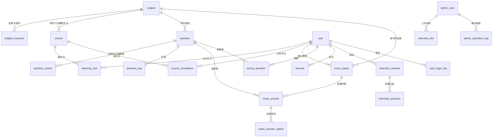

# 云枢智学 · 第三阶段设计：数据库设计

| 项 | 内容 |
|---|---|
| 文档版本 | v2.0（内容主干调整后重写，待评审） |
| 日期 | 2026-11-01 |
| 依据 | `docs/design/01.功能模块梳理.md`、`docs/design/02.整体架构设计.md`、`docs/rules/database-rules.md` |
| 交付物 | 本文档 + `scripts/sql/schema.sql`（20 张表，0 物理外键 / 12 唯一约束 / 28 普通索引） |
| 范围 | 实体关系、表结构、约束与索引、删除策略、规范自检；**不含**接口与业务代码 |

> **v2.0 变更说明**：v1.0 按「学科 → 阶段 → 课程 + 学习路线」设计。评审时确认内容主干改为**学科内课程线性节点图**，因此删除 `stage`、`learning_route`、`route_stage`、`user_route`、`stage_completion` 五张表，课程直接挂学科并带学习顺序；题目与答卷的归属从"阶段"上移到"学科"。原 v1.0 的「阶段完成率」概念作废，改为「学科完成率」。

---

## 1. 设计约定（对齐规范）

| 规范条目 | 落地方式 |
|---|---|
| 2.1 snake_case | 全部表名 / 字段名小写 + 下划线 |
| 2.3 单复数统一 | **全库单数**（`user`、`subject`、`course`） |
| 2.4 主键与外键命名 | 主键统一 `id`；关联字段统一 `{实体}_id` |
| 2.5 时间字段 | `created_at` / `updated_at`；业务时间单独命名（`visited_at`、`submitted_at`、`started_at`） |
| 3.1 类型准确 | 时长 `INT`（分钟）、文件大小 `BIGINT`、分数 `DECIMAL` |
| 3.2 必填约束 | 业务必填一律 `NOT NULL`；仅"结果尚未产生"字段允许 `NULL` |
| 3.4 精确数值 | 分值、总分全部 `DECIMAL` |
| 3.5 时区 | 所有 `DATETIME` 存 UTC，字段注释标注 |
| 3.6 状态字段 | 全部 `TINYINT UNSIGNED`，取值见第 7 节 |
| 3.7 禁止多值拼接 | 学科关键词、题目标签、答卷多选全部拆表 |
| 4.1 主键策略 | 统一 `BIGINT UNSIGNED AUTO_INCREMENT` |
| 4.2 禁止物理外键 | SQL 脚本内**无任何 `FOREIGN KEY`**；ORM 模型只声明普通 `xxx_id` 列（不使用 `ForeignKey` 关系字段），关联校验全部放在应用层 |
| 4.4 业务唯一值 | 手机号、用户名、学科名、`(学科, 课程名)`、`(学员, 课程)` 等均建唯一索引 |
| 3.2 / 4.5 数据库防线 | 唯一索引 + `NOT NULL` + 长度约束兜底 |
| — 字符集与引擎 | `InnoDB` + `utf8mb4` + `utf8mb4_0900_ai_ci` |

**软删除的实现取舍**：内容表统一加 `deleted_at`，但定义为 `NOT NULL DEFAULT '1970-01-01 00:00:00'` 而不是 `NULL`。MySQL 唯一索引允许多个 `NULL`，若用 `NULL`，"同一学科名不重复"在软删后会失效；用固定默认值后 `(业务键, deleted_at)` 组合唯一索引才能同时满足"未删除唯一"和"删除后可重建同名"。

---

## 2. 实体关系

**核心结构**：`subject` 是唯一的组织轴——课程、题目、答卷全部挂在学科下；学习顺序由 `course.sort_order` 决定；"点亮"由 `course_completion` 表达。

---

## 3. 表清单（20 张）

| 域 | 表 | 说明 |
|---|---|---|
| 账号 | `user` | 学员账号 |
| 账号 | `admin_user` | 后台账号（超管 / 运营） |
| 账号 | `user_login_log` | 登录日志，日 / 周活口径 |
| 内容 | `subject` | 学科（= 一条学习路径） |
| 内容 | `subject_keyword` | 学科检索关键词（拆表） |
| 内容 | `course` | 课程节点（含学习顺序 `sort_order`） |
| 学习 | `learning_visit` | 节点访问流水 |
| 学习 | `course_completion` | 节点点亮状态 |
| 题库 | `question` | 题目（挂学科） |
| 题库 | `question_option` | 选项 + 正确答案标记 |
| 题库 | `question_tag` | 题目标签（拆表） |
| 刷题 | `exam_paper` | 答卷（按学科组卷） |
| 刷题 | `exam_answer` | 逐题作答（含题干与选项快照） |
| 刷题 | `exam_answer_option` | 客观题所选选项（拆表） |
| 刷题 | `wrong_question` | 错题本（仅客观题） |
| 面试 | `interview_doc` | 面试资料库文档与处理状态 |
| 面试 | `resume` | 学员简历 |
| 面试 | `interview_session` | 面试会话 |
| 面试 | `interview_question` | 逐题记录（含追问与评分） |
| 系统 | `admin_operation_log` | 后台操作日志（含前后快照） |

---

## 4. 表结构

> 完整 DDL 见 `scripts/sql/schema.sql`，此处列业务字段与关键约束。

### 4.1 账号域

**user｜学员账号**

| 字段 | 类型 | 空 | 说明 |
|---|---|---|---|
| id | BIGINT UNSIGNED | 否 | 主键，自增 |
| phone | VARCHAR(20) | 否 | 手机号，唯一登录账号 |
| password_hash | VARCHAR(100) | 否 | 密码哈希 |
| nickname / city | VARCHAR(64) | 否 | 昵称 / 城市，默认 '' |
| status | TINYINT UNSIGNED | 否 | 1 正常 / 0 禁用 |
| last_login_at | DATETIME | 是 | 最近登录（UTC） |
| created_at / updated_at | DATETIME | 否 | 注册 / 更新时间（UTC） |

索引：`uk_user_phone`、`idx_user_created_at`、`idx_user_status`

**admin_user｜后台账号**：`username`(唯一)、`password_hash`、`role`(1 超管 / 2 运营)、`is_builtin`(1 内置不可删不可停用)、`status`；`uk_admin_user_username`

**user_login_log｜登录日志**：`user_id`、`login_at`、`ip`；`idx_user_login_log_user_time(user_id, login_at)`、`idx_user_login_log_login_at(login_at)`

> 日活 = 当日 `login_at` 去重 `user_id`；周活 = **近 7 天滚动**去重。验证码、Token、每日 3 次限流计数在 Redis，不落库。

### 4.2 内容域

**subject｜学科（= 学习路径）**

| 字段 | 类型 | 空 | 说明 |
|---|---|---|---|
| id | BIGINT UNSIGNED | 否 | 主键 |
| name | VARCHAR(64) | 否 | 学科名称（如 Agent 开发） |
| icon / description | VARCHAR(16) / VARCHAR(512) | 否 | 图标、简介 |
| sort_order | INT UNSIGNED | 否 | 学科展示排序 |
| status | TINYINT UNSIGNED | 否 | 1 上架 / 0 下架 |
| deleted_at | DATETIME | 否 | 软删除时间，默认 1970-01-01 |

索引：`uk_subject_name_deleted(name, deleted_at)`、`idx_subject_status_sort(status, sort_order)`

**subject_keyword｜检索关键词**：`subject_id`、`keyword`；`uk_subject_keyword(subject_id, keyword)`

**course｜课程节点**

| 字段 | 类型 | 空 | 说明 |
|---|---|---|---|
| id | BIGINT UNSIGNED | 否 | 主键 |
| subject_id | BIGINT UNSIGNED | 否 | 所属学科（逻辑关联） |
| title | VARCHAR(255) | 否 | 课程标题，即节点名 |
| description | VARCHAR(512) | 否 | 节点说明 |
| duration_minutes | INT UNSIGNED | 否 | 时长（分钟） |
| bilibili_url | VARCHAR(512) | 否 | B 站播放地址 |
| **sort_order** | INT UNSIGNED | 否 | **学科内学习顺序，节点图按此排列** |
| status | TINYINT UNSIGNED | 否 | 1 上架 / 0 下架 |
| deleted_at | DATETIME | 否 | 软删除时间 |

索引：`uk_course_subject_title_deleted(subject_id, title, deleted_at)`、`idx_course_subject_sort(subject_id, sort_order)`

> 只保留"线性顺序"一个排序字段，不需要依赖边表；"学完推荐下一个"= 取 `sort_order` 大于当前节点且未点亮的最小值。

### 4.3 学习行为域

**learning_visit｜访问流水**：`user_id`、`course_id`、`visited_at`；`idx_visit_user_time`、`idx_visit_course`

> 写入按「学员 + 课程 + 北京时间自然日」去重（已确认）：由应用层在写入前查询当日是否已有记录，**不额外加唯一键**（避免因时区换算把唯一约束写死在 UTC 上）。

**course_completion｜节点点亮**：`user_id`、`course_id`、`completed_at`（点亮时间）；`uk_course_completion(user_id, course_id)`

> 学科进度 = 该学科已点亮课程数 ÷ 该学科课程总数，**实时计算不落库**，避免课程增删后进度失真。

### 4.4 题库域

**question｜题目（挂学科）**

| 字段 | 类型 | 空 | 说明 |
|---|---|---|---|
| id | BIGINT UNSIGNED | 否 | 主键 |
| subject_id | BIGINT UNSIGNED | 否 | 所属学科（原为 stage_id，v2.0 上移） |
| type | TINYINT UNSIGNED | 否 | 1 判断 / 2 单选 / 3 多选 / 4 简答 |
| difficulty | TINYINT UNSIGNED | 否 | 1 简单 / 2 中等 / 3 困难 |
| category | VARCHAR(64) | 否 | 分类（对齐导入模板） |
| title | TEXT | 否 | 题干 |
| score | DECIMAL(5,2) | 否 | 分值 |
| reference_answer | TEXT | 是 | **仅简答题**的参考答案 |
| analysis | TEXT | 是 | 解析 / 评分要点 |
| status / deleted_at | — | 否 | 启用状态、软删除时间 |

索引：`idx_question_subject_type(subject_id, type)`、`idx_question_status`

**question_option｜选项**：`question_id`、`option_key`(CHAR(1))、`content`、`is_correct`、`sort_order`；`uk_question_option_key(question_id, option_key)`、`idx_option_question_correct`

> 判断题固定 A=正确、B=错误；多选可有多个 `is_correct=1`。正确答案不用拼接字符串表达。

**question_tag｜标签**：`question_id`、`tag_name`；`uk_question_tag`、`idx_tag_name`

### 4.5 刷题与错题域

**exam_paper｜答卷**

| 字段 | 类型 | 空 | 说明 |
|---|---|---|---|
| id | BIGINT UNSIGNED | 否 | 主键 |
| user_id | BIGINT UNSIGNED | 否 | 学员 |
| subject_id | BIGINT UNSIGNED | 否 | 组卷学科（原为 stage_id） |
| question_count / total_score | INT / DECIMAL(6,2) | 否 | 题数、总分 |
| obtained_score | DECIMAL(6,2) | 是 | 得分，判分中为空 |
| status | TINYINT UNSIGNED | 否 | 1 判分中 / 2 已完成；当前判分在请求内完成（预算 25 秒 + 关键词兜底），恒为 `2`，`1` 保留给未来的异步判分 |
| submitted_at | DATETIME | 否 | 提交时间（UTC） |

索引：`idx_paper_user_time`、`idx_paper_subject`、`idx_paper_status`

**exam_answer｜逐题作答**：`paper_id`、`question_id`、`question_title`(快照)、`question_type`(快照)、`score_max`、`score_obtained`、`is_correct`、`answer_text`、`reference_answer`、`ai_comment`、`judged_at`；`uk_answer_paper_question(paper_id, question_id)`、`idx_answer_question`

> 存题干与参考答案快照的原因：题库支持编辑，历史答卷必须能原样复现。

**exam_answer_option｜所选选项**：`answer_id`、`option_key`、`option_content`(快照)、`is_correct`(快照)；`uk_answer_option(answer_id, option_key)`

**wrong_question｜错题本**：`user_id`、`question_id`、`wrong_times`、`last_wrong_at`；`uk_wrong_user_question`、`idx_wrong_user_time`

> 只收客观题（应用层在写入前判断题型）；答对则删除该行。

### 4.6 面试域

**interview_doc｜资料库文档**：`file_name`、`file_type`(1 pdf / 2 md)、`file_size`、`oss_key`、`status`(1 待处理 / 2 转 md 中 / 3 已入库 / 4 解析失败)、`failure_reason`、`uploaded_by`、`deleted_at`；`idx_doc_status`、`idx_doc_uploaded_at`

> 切片与向量在 Milvus，MySQL 只存文件与状态；删除文档时应用层同步删除向量库中 `doc_id` 对应切片。

**resume｜简历**：`user_id`、`file_name`、`file_size`、`oss_key`、`status`(1 解析中 / 2 已就绪 / 3 解析失败)、`failure_reason`、`parsed_at`、`deleted_at`；`idx_resume_user_status`

> 重新上传按"替换"处理：旧行写 `deleted_at`，旧切片同步失效；不保留多份。

**interview_session｜会话**：`user_id`、`source`(1 学科 / 2 简历)、`subject_id`、`resume_id`、`question_count`、`status`(1 进行中 / 2 正常结束 / 3 超时结束 / 4 提前结束)、`total_score`、`duration_seconds`、`started_at`、`ended_at`；`idx_session_user_time`、`idx_session_source`、`idx_session_status`

**interview_question｜逐题**

| 字段 | 类型 | 空 | 说明 |
|---|---|---|---|
| id | BIGINT UNSIGNED | 否 | 主键 |
| session_id | BIGINT UNSIGNED | 否 | 会话 id |
| question_index | TINYINT UNSIGNED | 否 | 本场第几题 |
| question_text | TEXT | 否 | 生成题目文本快照 |
| source_type | TINYINT UNSIGNED | 否 | 1 资料库 / 2 简历 |
| source_doc_name | VARCHAR(255) | 否 | 来源文档名或项目名快照 |
| source_snippet_id | VARCHAR(64) | 否 | 向量库切片主键，便于追溯 |
| answer_mode | TINYINT UNSIGNED | 是 | 1 语音 / 2 打字 |
| answer_text | TEXT | 是 | 作答内容（语音为转写） |
| follow_up_text / follow_up_answer | TEXT | 是 | 追问与追问作答（每题最多 1 次，单值非拼接） |
| score / ai_comment / answered_at | — | 是 | 本题得分、点评、作答时间 |

索引：`uk_session_question_index(session_id, question_index)`、`idx_interview_question_source`

### 4.7 系统域

**admin_operation_log｜操作日志**：`admin_user_id`、`module`、`action`、`target_type`、`target_id`、`target_name`、`detail_before`(JSON)、`detail_after`(JSON)、`created_at`；`idx_log_created_at`、`idx_log_admin_time`、`idx_log_module`

---

## 5. 逻辑关联与删除策略

### 5.1 关联方式

全库**无物理外键**（规范 4.2），完整性由应用层校验：

| 关联 | 字段 | 应用层校验点 |
|---|---|---|
| 课程 → 学科 | `course.subject_id` | 建课程时校验学科存在且未删除 |
| 题目 → 学科 | `question.subject_id` | 录题时校验学科存在 |
| 答卷 → 学员 / 学科 | `exam_paper.user_id` / `subject_id` | 组卷与提交时校验 |
| 作答 → 答卷 / 题目 | `exam_answer.paper_id` / `question_id` | 提交时校验 |
| 面试 → 学科 / 简历 | `interview_session.subject_id` / `resume_id` | 发起时校验归属 |
| 日志 → 操作人 | `admin_operation_log.admin_user_id` | 取当前登录后台账号 |

### 5.2 软删除范围

| 表 | 软删除 | 说明 |
|---|---|---|
| subject / course | 是 | 删后 C 端不展示，历史访问与点亮记录保留 |
| question / question_option / question_tag | 题目软删 | 选项与标签随题目整体失效，不单删 |
| interview_doc / resume | 是 | 文件与解析状态保留可追溯；简历替换时旧行置删 |
| 学员、答卷、错题、面试记录、日志 | 否 | 行为数据长期保留（PRD 假设项） |

### 5.3 删除动作的业务约束

| 场景 | 规则 |
|---|---|
| 删学科 | **学科下还有未删除的课程时禁止删除**，提示先删除或下架课程（已确认） |
| 删课程 | 允许；历史访问与点亮记录保留（靠 `course_id` 仍能取到软删行） |
| 删题目 | 允许；历史答卷靠 `exam_answer` 的快照复现 |
| 删资料库文档 | 软删 + 同步删除 Milvus 中该文档的切片 |
| 删简历 | 重新上传时旧行置删 + 同步删除个人简历库切片 |

---

## 6. 索引与唯一约束

| 类型 | 数量 | 覆盖内容 |
|---|---|---|
| 唯一约束 | 12 | 手机号、用户名、学科名、`(学科, 课程名)`、`(学员, 课程)`、选项、标签、`(答卷, 题目)`、作答选项、`(学员, 题目)`、`(会话, 题序)`、学科关键词 |
| 普通索引 | 28 | 看板（注册时间、登录时间）、课程排序、访问与点亮、答卷与错题、面试记录、日志检索 |

| 高频场景 | 走的索引 |
|---|---|
| 看板今日新增 / 注册趋势 | `idx_user_created_at` |
| 看板日活 / 周活（近 7 天） | `idx_user_login_log_login_at` + 去重 |
| 学科节点图（按顺序取课程） | `idx_course_subject_sort` |
| 节点点亮判定 | `uk_course_completion` + `idx_course_completion_course` |
| 最近学习 | `idx_visit_user_time` |
| 错题本列表 | `idx_wrong_user_time` |
| 历史答卷 | `idx_paper_user_time` |
| 面试记录 | `idx_session_user_time` |
| 后台按模块查日志 | `idx_log_module` |

---

## 7. 状态字典

| 表.字段 | 取值 |
|---|---|
| `user.status` | 1 正常，0 禁用 |
| `admin_user.role` | 1 超管，2 运营 |
| `admin_user.is_builtin` | 1 内置（不可删/停用），0 普通 |
| `admin_user.status` | 1 启用，0 停用 |
| `subject.status` / `course.status` | 1 上架，0 下架 |
| `question.type` | 1 判断，2 单选，3 多选，4 简答 |
| `question.difficulty` | 1 简单，2 中等，3 困难 |
| `question.status` | 1 启用，0 停用 |
| `exam_paper.status` | 1 判分中（仅同步判分超时降级），2 已完成 |
| `exam_answer.is_correct` | 1 对，0 错，NULL 简答 |
| `interview_doc.file_type` | 1 pdf，2 md |
| `interview_doc.status` | 1 待处理，2 转 md 中，3 已入库，4 解析失败 |
| `resume.status` | 1 解析中，2 已就绪，3 解析失败 |
| `interview_session.source` | 1 学科面试，2 简历面试 |
| `interview_session.status` | 1 进行中，2 正常结束，3 超时结束，4 提前结束 |
| `interview_question.source_type` | 1 资料库，2 简历 |
| `interview_question.answer_mode` | 1 语音，2 打字，NULL 未作答 |

---

## 8. 规范符合性自检

| 规范条款 | 结果 |
|---|---|
| snake_case、无保留字 | 通过；`user` / `question` 非 MySQL 8 保留字，且脚本统一加反引号 |
| 表名单复数统一 | 通过；全库单数 |
| 主键统一 `id` 自增 | 通过；20 张表一致 |
| 禁止物理外键 | 通过；脚本内 `FOREIGN KEY` 数量为 0（已用脚本核对），ORM 侧不声明关系字段，仅保留 `xxx_id` 普通列 |
| 业务唯一值有唯一约束 | 通过；12 组唯一键 |
| 必填字段 NOT NULL | 通过；仅结果未产生字段留空 |
| 默认值有业务含义 | 通过；`1970-01-01` 明确表示未删除 |
| 金额/分值定点数 | 通过；`DECIMAL(5,2)` / `DECIMAL(6,2)` |
| 时间统一 UTC | 通过；字段注释标注（UTC） |
| 状态字段有限且有文档 | 通过；第 7 节字典 + 字段注释 |
| 多值不拼接 | 通过；关键词、标签、多选作答三处拆表 |
| 完整性不只靠前端 | 通过；唯一索引 + NOT NULL + 长度约束 + 应用层关联校验 |

---

## 9. 待确认问题

| 编号 | 问题 | 现状设计 | 影响 |
|---|---|---|---|
| D1 | 组卷规则：每卷题量、题型比例、是否随机抽题、重复刷题是否重复抽题 | 未定，表结构不依赖该规则 | 仅影响 `exam_paper.question_count` 的取值与查询逻辑（PRD 第 7 节第 1 项） |
| D2 | 整卷是否限时、是否限制重做次数 | 表结构已能支持（`submitted_at`、多次 `exam_paper`） | 只需应用层规则 |
| D3 | 同一门课程是否允许被多个学科复用 | 当前按**单一归属**设计（`course.subject_id` 一值） | 若要跨学科复用，需加 `course_subject` 关联表 |
| D4 | 是否需要在学科上记录"学员当前主学学科" | 未建表，学员可自由浏览所有学科 | 若要首页展示"继续学习"，可直接按最近 `learning_visit` 推断，不必建表 |

> 上一轮 Q2/Q3/Q4 已确认：简历替换置删、周活按近 7 天滚动、面试发起即扣配额（不退还）。

---

## 10. 附：文档与原型同步状态

内容主干调整后，以下三处已全部同步完成：

| 对象 | 同步内容 | 状态 |
|---|---|---|
| `docs/PRD.md` | §2 权限、§3 领域结构、§4.2 首页、§4.3 学科与课程节点图、§4.4 点亮与学科完成率、§5 后台模块（去掉阶段与学习路线管理）、§6 不做清单、§8 假设项 | 已完成 |
| `docs/design/01.功能模块梳理.md` | 重写为 v2.0：C2/C3/C4 调整、删除 B3 学习路线管理（B 端 8 → 7 个模块）、依赖图与流程同步、新增 Q13–Q17 确认项 | 已完成 |
| `docs/design/02.整体架构设计.md` | 升级 v2.0：模块编号 B1–B7、§4.1 接口分包与 04 的 URL 前缀对齐、目录去掉路线/阶段视图、Redis 职责补令牌与配额 | 已完成 |
| `prototype/` | 删除路线页 / 阶段页 / 我的路线；学科页改为课程节点图（点亮、推荐下一课）；刷题改为按学科组卷；后台去掉"学习路线"菜单，课程内容改为学科 → 课程两级并支持上移/下移排序 | 已完成 |
